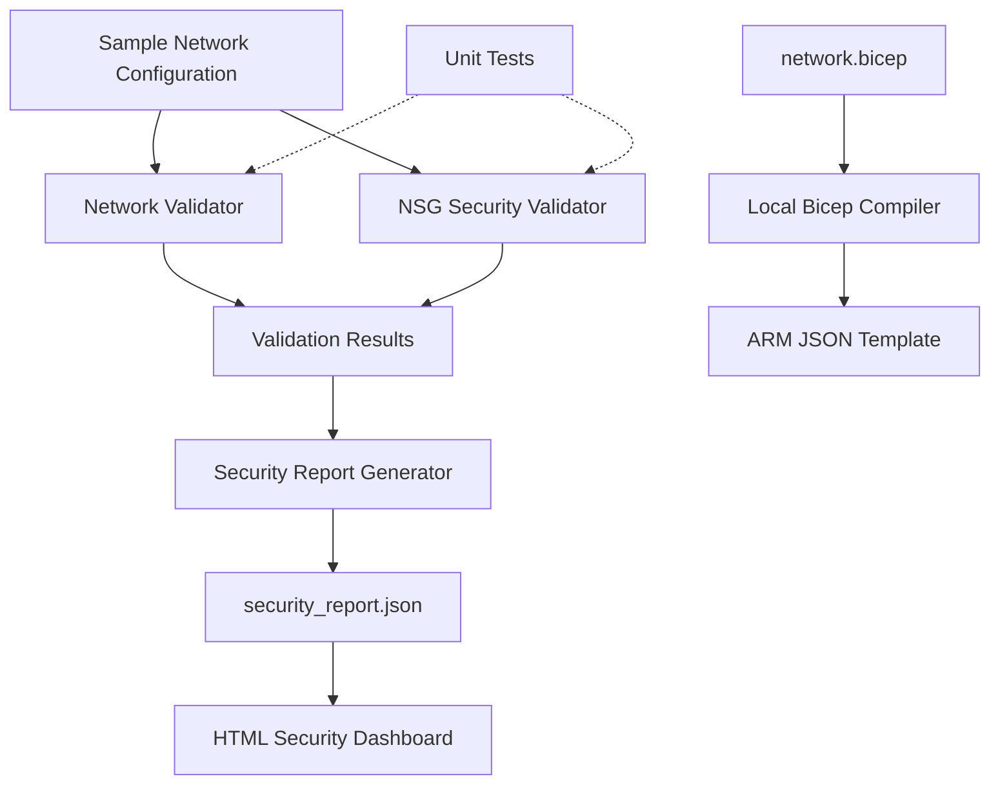

# AzureOps Architecture

## Overview

AzureOps is a local cloud infrastructure validation and security monitoring prototype. It uses Python validation scripts, JSON report generation, a browser-based dashboard, and Azure Bicep infrastructure code.

## Architecture Diagram

## Components

### 1. Network Validator

Checks subnet CIDR configurations, identifies overlapping subnets, and detects subnets outside the configured virtual network address space.

### 2. NSG Security Validator

Checks inbound security rules and flags potentially risky configurations, such as SSH access exposed to the public internet.

### 3. Security Report Generator

Collects validation findings and writes them to `data/security_report.json`.

### 4. Security Dashboard

Reads the generated JSON report and displays security finding counts and details in a local browser.

### 5. Infrastructure as Code

The `infra/network.bicep` file defines an Azure virtual network and two subnets. The Bicep CLI compiles this file locally into an ARM JSON template.

### 6. Automated Tests

Python unit tests verify network validation and NSG security detection behavior.

## Data Flow

1. Sample network and security configurations are checked by Python validation scripts.
2. The report generator writes the findings to a JSON file.
3. The browser dashboard reads the report and presents the results.
4. Separately, the Bicep file is compiled locally into an ARM JSON template.

## Current Scope and Limitations

- The project runs locally and uses sample configuration data.
- It does not deploy resources to Azure.
- It does not connect to a live Azure subscription.
- Dashboard findings reflect the local report, not a live cloud security assessment.

## Technologies

Python, Azure Bicep, ARM JSON, HTML, CSS, JavaScript, and Python `unittest`.